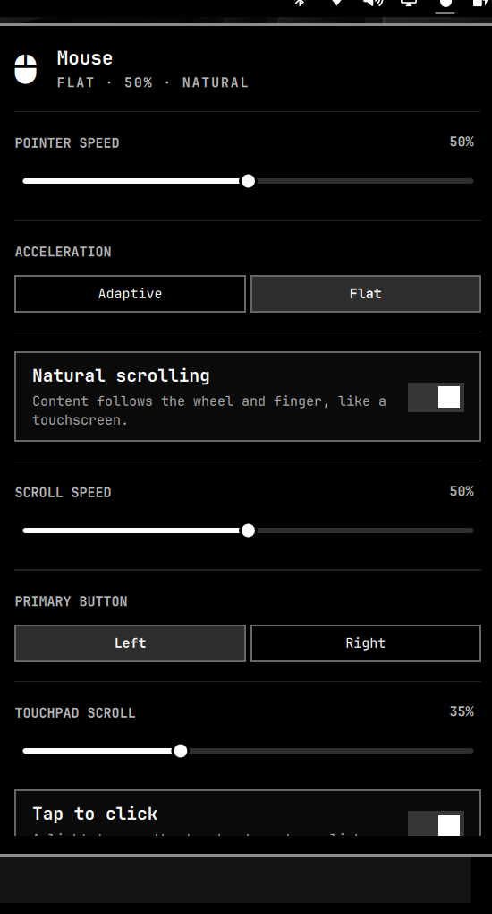

# Mouse

Bar widget for Omarchy pointer settings. The panel shows a Mouse group and a
Touchpad group for whatever is connected, each with its own speed, scroll speed,
acceleration, primary button and natural scrolling, plus the common touchpad
controls. Detection is a best guess, so the panel can show a hidden group by hand.



## Install

```sh
omarchy plugin add https://github.com/wouldja/omarchy-mouse.git --enable
```

The widget lands on the right of the bar. If it does not appear immediately:

```sh
omarchy-shell shell rescanPlugins
```

Click the icon to open the panel. Scroll the icon to nudge mouse speed, or
touchpad speed when no mouse is connected.

## Remove

```sh
omarchy plugin remove io.github.wouldja.mouse
```

Removal does not delete Hyprland files the panel already wrote. If you want
those gone too:

1. Delete `~/.config/hypr/mouse.lua`
2. Remove the `require("hypr.mouse")` line from `~/.config/hypr/hyprland.lua`

## What it changes

Using a control in the panel applies the value immediately through `hyprctl eval`
and, on commit, writes:

- `~/.config/hypr/mouse.lua` — generated pointer settings, including an
  `hl.device` line per touchpad for the settings Hyprland shares with the mouse
- `~/.config/hypr/hyprland.lua` — adds `require("hypr.mouse")` if it is missing
  (the rest of the file is left alone)

It does not edit `/usr/share/omarchy` or request elevated permissions.

## License and dependencies

MIT. See [LICENSE](LICENSE).

Needs Omarchy (Quickshell) and Hyprland. Uses `hyprctl` and Python 3 from the
base system. No extra packages, network calls, or installers.
